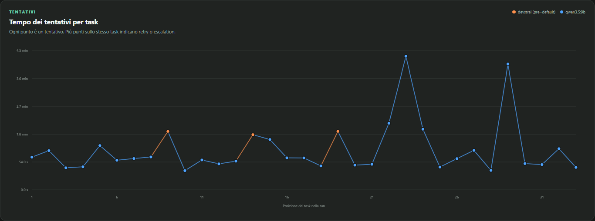
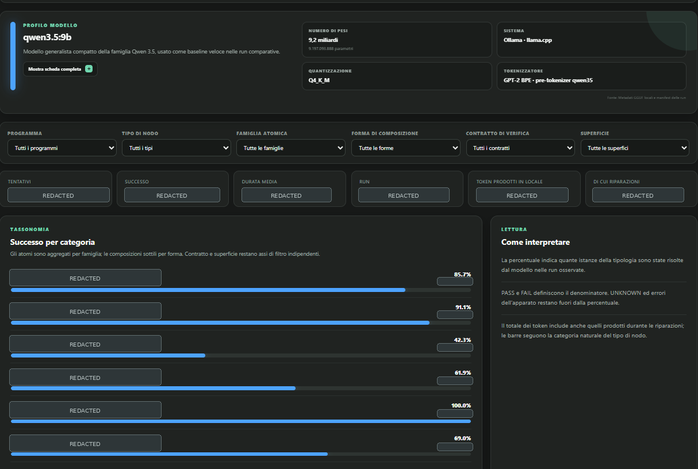

# EXEC — System Architecture

EXEC is an experimental framework for orchestrating locally hosted language models across **bounded, independently verifiable software-development tasks**. It runs on a personal workstation and can orchestrate LLMs that fit within its available RAM and VRAM. The system is designed around explicit execution policies, dependency management, recovery, and traceability rather than an unrestricted agent loop.

This document is a **high-level view of the implemented system and its conceptual foundations**, not a copy of the private source repository's directory tree.

## Architecture at a glance

```text
EXEC
├── Conceptual framework
│   └── Atom Taxonomy
│       ├── Semantic atoms
│       ├── Thin compositions
│       └── Verification contracts
│
├── Execution runtime
│   ├── Task specifications and dependency management
│   ├── Configurable execution and model policies
│   ├── Local LLM backends and file operations
│   └── Checkpoints, retries, and recovery
│
├── Verification
│   └── Independent task-level checks
│
├── Execution evidence and observability
│   ├── Manifests, event logs, and attempt records
│   └── SQLite analytics and local monitoring dashboard
│
└── Separate research tools
    ├── Repair and replay
    └── Embedding analysis
```

The boxes represent **responsibilities**, not necessarily one-to-one Python packages or automatically connected processing stages.

## How an execution works

1. **Define the work.** An execution packet specifies the task goal, relevant context, permitted file scope, verification reference, and dependencies on other packets.
2. **Check dependencies.** The runner executes eligible tasks and does not launch tasks whose required predecessors have failed.
3. **Select a local model.** A versioned run policy specifies model roles, attempt order, context limits, and other execution constraints. Model calls are served locally through Ollama or compatible inference servers.
4. **Attempt and verify.** The model interacts with the task workspace through bounded file operations. A separate verifier evaluates the candidate result; the runner does not decide semantic correctness by interpreting the model's answer.
5. **Recover or proceed.** Successful tasks allow dependent work to continue. Unsuccessful attempts can be retried from a controlled task-start state according to policy; interruptions are recoverable at task boundaries.
6. **Record what happened.** The runner retains execution manifests, attempt and verification records, event logs, and state checkpoints. A separate analytics layer ingests execution evidence for inspection through a local dashboard.

## Atom Taxonomy: a conceptual foundation

The **Atom Taxonomy** provides a language for describing software work through semantic transformations, structural compositions, and verification contracts. It helps make the intended meaning and acceptance criteria of execution packets explicit.

The taxonomy **guides packet design**. It should not be read as a claim that the current runtime automatically compiles taxonomy definitions into executable tasks. Execution policies, task dependencies, and verification remain distinct concerns.

## Separation of responsibilities

| Component | Responsibility |
| --- | --- |
| **Runner** | Orchestrates task attempts, model selection, dependency gates, and recovery. |
| **Local inference** | Produces candidate code changes through configured local model backends. |
| **Verification** | Checks task outcomes independently of the model's self-assessment. |
| **Execution records** | Preserve configuration, actions, outcomes, and recovery information. |
| **Observatory** | Reads execution evidence into a separate SQLite analytical store and displays it locally. |
| **Research tools** | Explore repair/replay and embedding methods outside the operational runner. |

## Observatory

EXEC includes a local observability dashboard for inspecting execution traces, task attempts, model usage, timing, and performance across execution packets.



*Example view of successful task attempts. The horizontal axis represents task position within the run, while the vertical axis shows attempt duration. Colors distinguish the models involved in execution and recovery.*

### Model analysis

The observability layer also includes analytical views for examining model-specific behavior across filtered task categories.



*Example model-analysis view for Qwen3.5 9B. Selected fields are intentionally redacted for public sharing. The interface supports filtered inspection of category-level success patterns while preserving sensitive experimental details.*

## Technical environment

**Python - Git - SQLite - Ollama - Local LLM inference - Starlette**

The architecture prioritizes locally controlled inference and observable execution on **consumer hardware**. Model selection and runtime configuration can change without changing the overall separation between orchestration, verification, and analysis.
