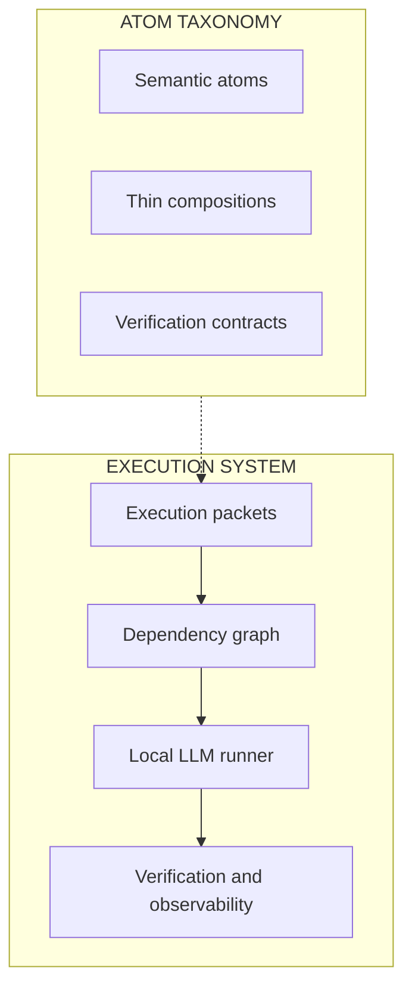

# EXEC
Local AI orchestration - Verifiable software development - Consumer hardware

EXEC is an experimental framework I designed to investigate how lightweight, locally hosted language models can carry out extended sequences of software-development tasks while keeping execution **verifiable, traceable, and recoverable**.

The execution environment runs on my Windows PC with **32 GB of RAM**, using Ollama and locally hosted model servers. Model inference does not depend on pay-per-call cloud APIs. Working within these hardware constraints is a central part of the engineering challenge.
## Core concept: Atom Taxonomy

A central idea behind EXEC is the **Atom Taxonomy**: a conceptual framework for representing software work as small, explicit, and verifiable units.

Instead of treating software generation as a single opaque task, EXEC breaks it down into structured elements:

- **Semantic atoms**: minimal units that introduce a meaningful software transformation.
- **Thin compositions**: structural links between transformations that do not introduce a new semantic change.
- **Verification contracts**: explicit criteria used to determine whether a result is acceptable.

These elements provide a common language for describing what a task is, how it relates to other tasks, and how its result should be checked.

In EXEC, this framework supports the construction of **execution packets** and **dependency graphs**, making software-development work more modular, inspectable, and verifiable.
This taxonomy is one of the core conceptual pillars of the project.

## What is implemented
- **Execution runner:** dependency-aware task processing, configurable local models and attempt policies, retries, escalation, Git-backed checkpoints, and recovery after interruptions.
- **Verification framework:** per-task checks, qualified benchmark design with negative controls, and recorded outcomes and provenance.
- **Observability:** structured execution records, a SQLite analytical store, and a local dashboard for examining attempts, model behavior, timing, and failure patterns.
Separate research tools explore repair/replay strategies and representation of software atoms. They are not presented as production-ready components of the runner.
## Engineering approach
I lead the project's conceptual design, system architecture, experimental methodology, and technical evaluation. Python implementation has been developed with AI coding assistance, including Claude Code and Codex, under iterative review and verification.

For a technical overview, see the [System Architecture](ARCHITECTURE.md).

## Local execution environment

- **Hardware:** Windows PC, 32 GB RAM, Intel Arc GPU.
- **Models used:** Qwen3.5 9B, Devstral Small 2 24B, Bonsai.
- **Inference:** Ollama and local model-serving infrastructure.
- **Architecture:** Configurable model selection and multi-model execution policies.

Stack: Python - Git - SQLite - Ollama - local LLM inference - Starlette

Status: active research prototype. The project demonstrates a working experimental infrastructure; reliable general-purpose autonomous software development remains a research objective. Operational run data and the full development repository remain private.
